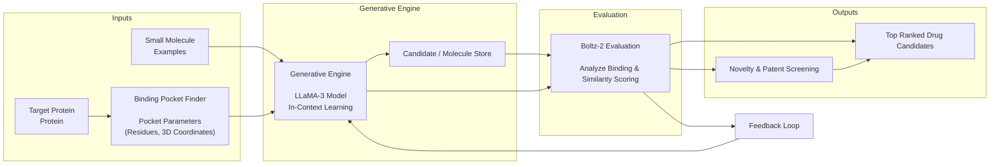
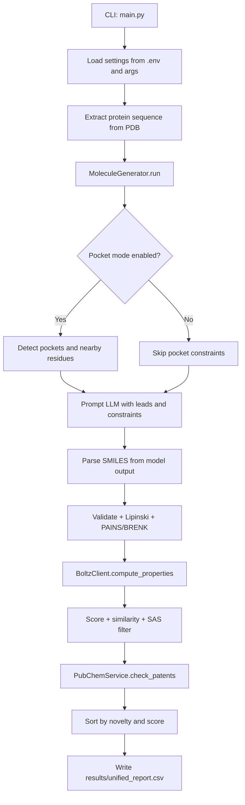

# LLMsFold: AI Molecular Generation Framework

LLMsFold is an automated molecule generation pipeline for early drug discovery. It combines LLM-driven proposal generation with NVIDIA Boltz scoring, chemistry filters, and PubChem novelty checks.

## Authors

- Wageesha Widuranga `†`  
  [](https://www.maps.unipd.it/en/department)

- Davide Rigoni `†`  
  [](https://www.math.unipd.it/en/)

- Fabio Bove `†`  
  [](https://www.maps.unipd.it/en/department)
  [](https://www.unimore.it/en/university/departments-schools-and-faculties/department-physical-computer-and-mathematical-sciences)
  [](https://tacclab.org/)
  [](https://www.neoralab.com/)

- Dario Righelli  
  [](https://www.unipd.it/en/en/university/scientific-and-academic-structures/departments/department-biology)
  [](https://www.cst.cam.ac.uk/)

- Salvatore Romano  
  [](https://www.dieei.unict.it/en/)
  [](https://www.cst.cam.ac.uk/)
  [](https://www.unicampus.it/en/)

- Rosa Visone  
  [](https://www.cast.unich.it/en/)

- Marilena V. Iorio  
  [](https://www.istitutotumori.mi.it/en)

- Marco Grassia  
  [](https://www.dieei.unict.it/en/)

- Giuseppe Mangioni  
  [](https://www.dieei.unict.it/en/)

- Pietro Lio `§`  
  [](https://www.cst.cam.ac.uk/)

- Cristian Taccioli `§*`  
  [](https://www.maps.unipd.it/en/department)
  [](https://www.cst.cam.ac.uk/)
  [](https://tacclab.org/)

## Affiliations

- [](https://www.maps.unipd.it/en/department) Department of Animal Medicine, Production and Health (MAPS), University of Padova, Legnaro, Italy
- [](https://www.cst.cam.ac.uk/) Department of Computer Science and Technology, William Gates Building, University of Cambridge, Cambridge CB3 0FD, UK
- [](https://www.cast.unich.it/en/) Center for Advanced Studies and Technology (CAST), and Department of Medical, Oral and Biotechnological Sciences, G. d'Annunzio University, Chieti, Italy
- [](https://www.istitutotumori.mi.it/en) Department of Experimental Oncology, Fondazione IRCCS Istituto Nazionale Tumori, Milan, Italy
- [](https://www.unimore.it/en/university/departments-schools-and-faculties/department-physical-computer-and-mathematical-sciences) Department of Physical, Computer and Mathematical Sciences (FIM), University of Modena and Reggio Emilia, Modena, Italy
- [](https://www.unipd.it/en/en/university/scientific-and-academic-structures/departments/department-biology) Department of Biology, University of Padova, Padova, Italy
- [](https://www.dieei.unict.it/en/) Department of Electrical, Electronic and Computer Engineering, University of Catania, Catania, Italy
- [](https://www.unicampus.it/en/) University Campus Bio-Medico of Rome, Rome, Italy
- [](https://www.math.unipd.it/en/) Dipartimento di Matematica "Tullio Levi-Civita", University of Padova, Padova, Italy

## Author Notes

- `†` Co-first authors
- `§` Co-senior authors
- `*` Corresponding author

## Preprint
- `LLMsFold: Integrating Large Language Models and Biophysical Simulations for De Novo Drug Design`
- bioRxiv: https://www.biorxiv.org/content/10.64898/2026.03.02.709055v1

## The LLMsFold Framework


## Architecture

## Key Features
- Async end-to-end orchestration with reusable HTTP clients.
- Pocket-aware mode with residue-constrained Boltz requests.
- Iterative LLM loop with context leads across rounds.
- RDKit filters (validity, Lipinski, PAINS/BRENK, SAS cutoff).
- Built-in novelty and patent signal checks via PubChem APIs.

## Repository Layout
```text
LLMsFold/
|- main.py
|- run.sh
|- .env.example
|- src/
|  |- generator.py
|  |- nvidia_client.py
|  |- chemistry.py
|  |- pocket.py
|  |- prompt.py
|  |- schemas.py
|  |- clients/factory.py
|  |- services/pubchem.py
|  `- core/{config,constants,logging}.py
|- tests/
|- data/
|  |- acvr1_R206H_clean.pdb        # ACVR1 target (R206H mutant modelled)
|  |- 19CD_only_rare_disorder.pdb  # CD19 target
|  |- smiles_ACVR1.csv             # ACVR1 seed molecules + PubChem CIDs
|  |- few_shot_cd19.csv            # CD19/BCR seed molecules + PubChem CIDs
|  `- few_shot_smiles_patent.csv   # legacy default seed set
|- images/
`- doc/
```

## Requirements
- Python `>=3.12`
- API keys:
  - `GROQ_API_KEY`
  - `NVIDIA_API_KEY`

## Setup
### 1. Install dependencies with uv (recommended)
```bash
uv sync --group dev
```

### 2. Configure environment
```bash
cp .env.example .env
```
Fill in API keys and adjust paths as needed.

## Configuration
| Variable | Required | Default | Description |
| --- | --- | --- | --- |
| `GROQ_API_KEY` | Yes | - | Groq API key for LLM generation |
| `NVIDIA_API_KEY` | Yes | - | NVIDIA API key for Boltz predictions |
| `PDB_FILE` | No | `data/acvr1_R206H_clean.pdb` | Target protein PDB path |
| `FEW_SHOT_CSV` | No | `data/few_shot_smiles_patent.csv` | Seed molecules CSV (`;` separated, `Smiles` column; optional `PubChem_CID` column for provenance). Use `data/smiles_ACVR1.csv` for ACVR1 and `data/few_shot_cd19.csv` for CD19. Only the first `SEED_SMILES_LIMIT` (5) rows are used. |
| `OUTPUT_DIR` | No | `results` | Output directory |
| `MAX_ITERATIONS` | No | `3` | RL-style loop iterations |
| `MAX_SAMPLES` | No | `5` | LLM proposals per iteration |
| `LLM_MODEL` | No | `llama-3.3-70b-versatile` | Groq model name |
| `LLM_TEMPERATURE` | No | `0.8` | LLM temperature (`0.0` to `2.0`) |
| `BEST_STRUCTURE_AFFINITY_THRESHOLD` | No | - | Save Boltz docked structures for candidates with `Boltz2_Binding_Probability` above this threshold (`0.0` to `1.0`) |
| `IPTM_THRESHOLD` | No | `0.95` | Minimum Boltz `ipTM` required to keep a candidate (`0.0` to `1.0`) |
| `PLDDT_THRESHOLD` | No | `0.9` | Minimum Boltz `pLDDT` required to keep a candidate (`0.0` to `1.0`) |
| `SIMILARITY_PENALTY_THRESHOLD` | No | `0.6` | Tanimoto similarity at which the reward's novelty penalty starts ramping in (`0.0` to `1.0`) |
| `SIMILARITY_PENALTY_FRACTION` | No | `0.5` | Largest share of the binding probability the novelty penalty can remove, reached at similarity 1.0 (`0.0` disables it) |
| `ENABLE_HOLDOUT_EVALUATION` | No | `true` | Run independent evaluators on finished candidates after generation |
| `VINA_RECEPTOR_PDBQT` | No | - | Prepared receptor PDBQT enabling Vina rescoring; without it Vina reports itself unavailable |
| `POCKET_RESIDUES` | No | - | Use these residues as the pocket instead of detecting one (e.g. `A:203,A:207`) |
| `POCKET_LIGAND` | No | - | Use the residues around this bound ligand as the pocket (e.g. `ATP` or `ATP:A:401`) |
| `POCKET_CENTER` | No | - | Use the residues around this point as the pocket, as `x,y,z` |
| `POCKET_INDEX` | No | - | Pin a specific detected pocket by its 0-based index |
| `POCKET_CONTACT_DISTANCE` | No | `8.0` | Radius in Å used by `POCKET_LIGAND` and `POCKET_CENTER` |
| `LEAD_DIVERSITY_MAX_SIM` | No | `0.7` | A candidate is fed back as a new prompt lead only if it is below this similarity to every existing lead (`0.0` to `1.0`) |
| `RANDOM_SEED` | No | - | Seed applied to Python/NumPy RNG and passed to the Groq chat completion call for more reproducible runs |
| `BOLTZ_RETRY_ATTEMPTS` | No | `4` | Retry budget for Boltz HTTP `429` responses |
| `BOLTZ_RETRY_MIN_WAIT_SECONDS` | No | `2.0` | Initial tenacity backoff for Boltz HTTP `429` responses |
| `BOLTZ_RETRY_MAX_WAIT_SECONDS` | No | `30.0` | Maximum tenacity backoff for Boltz HTTP `429` responses |
| `LOG_LEVEL` | No | `INFO` | Logging level |

## Usage
### Run with uv
```bash
uv run --env-file .env main.py --iters 3 --samples 5
```

### Run with helper script
```bash
chmod +x run.sh
./run.sh
```

### Non-interactive mode
Pocket selection is interactive when enabled. For CI or batch runs, disable it:
```bash
uv run --env-file .env main.py --no-pocket
```

### Choosing the binding pocket
By default the pocket is found by geometry. When the site is already known —
from a co-crystallised ligand, from mutagenesis, or from the literature — that
knowledge beats a hull search, so it can be given directly. Pick **one**:

```bash
# Residues you name. Accepts 'A:203', a bare '203', or the detected 'ALA203_A'.
uv run --env-file .env main.py --pocket-residues "A:206,A:207,A:210"

# The residues around a ligand bound in the input structure.
uv run --env-file .env main.py --pocket-ligand ATP
uv run --env-file .env main.py --pocket-ligand ATP:A:401   # one copy of several

# The residues around a point in the structure's own coordinate frame.
uv run --env-file .env main.py --pocket-center "32.4,-21.2,52.0"

# A specific detected pocket, instead of accepting automatic selection.
uv run --env-file .env main.py --pocket-index 2
```

`--pocket-contact-distance` sets the radius used by `--pocket-ligand` and
`--pocket-center` (default 8 Å). Each flag also has an environment variable
(`POCKET_RESIDUES`, `POCKET_LIGAND`, `POCKET_CENTER`, `POCKET_INDEX`,
`POCKET_CONTACT_DISTANCE`) for use from `.env`.

Two behaviours worth knowing:

- **A pocket you named is never silently dropped.** If automatic detection
  fails, the run falls back to few-shot mode with a warning. If a pocket *you*
  specified cannot be resolved, the run stops — continuing would spend the
  whole API budget on a site you did not ask for while the report still looked
  normal.
- **The manifest records which source was used.** `run_manifest.json` carries
  `pocket.mode` (`auto`, `residues`, `ligand`, `center`, `index`, `disabled` or
  `detection_failed`), a `user_specified` flag, and the exact selection. This
  keeps automated discovery distinguishable from an expert-guided site.

### Reference inhibitor baseline
Score the few-shot reference inhibitors through the same predictor, pocket
constraints, and composite score as the generated candidates, so published
candidate tables can be read against a like-for-like baseline:
```bash
uv run --env-file .env main.py --score-references
```
References are scored before generation begins and are never added to the
candidate ranking, the similarity-penalty registry, or the prompt feedback
pools.

## Output
Primary artifact: `results/unified_report.csv`

Always written:
- `results/run_manifest.json` — provenance for the run: every resolved
  threshold, the redacted settings, SHA-256 digests of the input PDB and
  seed CSV, code and package versions, per-iteration outcome, and stage
  timings. Because all four scoring gates are environment-configurable, two
  runs can produce identically-shaped CSVs under different thresholds; the
  manifest is what makes a given report auditable and reproducible. It is
  written before scoring starts and rewritten at the end, so an interrupted
  run still leaves its configuration behind.

Independent (holdout) evaluation columns, when enabled:
- `PoseBusters_Pass`, `PoseBusters_Checks_Passed`, `PoseBusters_Checks_Total`,
  `PoseBusters_Failed_Checks`, `PoseBusters_Bond_Orders_Assigned`
- `Vina_Score_kcal_per_mol`, `Vina_Minimized_kcal_per_mol`, `Vina_Minimization_Gain`

These come from evaluators that ran **after** generation finished and took no
part in selecting the molecules, so unlike every other score in the report they
are not something the pipeline optimized toward. PoseBusters checks whether a
pose is physically possible (bond geometry, internal and protein clashes, ring
flatness, pocket occupancy) using rules rather than a learned model, so it
cannot be circular with the predictor that produced the pose. Vina rescores the
same pose with an empirical scoring function that shares no training data with
the co-folding model.

Both are optional. Installation differs by evaluator.

**PoseBusters** installs cleanly:

```bash
uv pip install posebusters
```

**Vina** does not install from PyPI on macOS. Its `setup.py` searches only
conda, `/usr/local` and `/usr` for Boost, so it misses Homebrew's
`/opt/homebrew` prefix on Apple Silicon; and recent Boost (1.90) requires
Clang 19 or newer, while Apple's current toolchain ships Clang 16, so the
build fails on missing `__builtin_ctzg`/`__builtin_clzg` even once Boost is
found. Use the conda-forge binary instead:

```bash
conda create -y -n vina-holdout -c conda-forge python=3.12 vina
SP=$(conda run -n vina-holdout python -c "import vina,os;print(os.path.dirname(os.path.dirname(vina.__file__)))")
cp -R "$SP/vina" .venv/lib/python3.12/site-packages/
# The extension resolves Boost through @rpath relative to the venv root,
# so those libraries have to sit beside it.
cp -a "$SP/../lib"/libboost_{thread,filesystem,system,atomic,chrono}*.dylib .venv/lib/
uv pip install meeko gemmi   # gemmi is an undeclared meeko dependency
```

On Linux, `uv pip install vina meeko gemmi` generally works given Boost
development headers.

Vina needs no prepared receptor: a co-folding model returns its complex in
its own coordinate frame rather than the input structure's, so the receptor
is built per complex from that complex's own protein atoms, using
`mk_prepare_receptor.py` from meeko.

Optional artifacts:
- `results/reference_baseline.csv` (when `--score-references` is passed) —
  one row per reference inhibitor with the same metrics as candidate rows,
  a leave-one-out similarity column, and `Passes_*_Gate` flags showing
  whether the run's own thresholds would have admitted a known inhibitor.
- `results/best/<candidate-id>/data/metadata.json` (when
  `BEST_STRUCTURE_AFFINITY_THRESHOLD` is set) containing the candidate
  `smiles`, Boltz `evaluation`, `pdb`, and `structure` payload for
  high-affinity hits.

Important columns include:
- Predicted activity/confidence: `Boltz2_Binding_Probability`,
  `Boltz2_Predicted_Affinity_pIC50`, `Boltz2_Predicted_Affinity_uM`,
  `Boltz2_pTM`, `Boltz2_ipTM`, `Boltz2_Complex_pLDDT`
- Drug-like properties: `MolWt`, `LogP`, `QED`, `SAS`, `TPSA`, `H_Acceptors`, `H_Donors`
- Scaffold novelty: `Murcko_Scaffold`, `Generic_Scaffold`, `Scaffold_Is_Novel`,
  `Generic_Scaffold_Is_Novel`, `Max_Scaffold_Sim_To_Seeds`
- Ranking/novelty: `MaxSim`, `Adj_Binding_Probability`, `score`, `PubChem_CID`,
  `PubChem_Known`, `PubChem_Classification`

Every column carrying a `Boltz2_` prefix is a model output, not a measurement.
`Boltz2_Binding_Probability` (a binder/non-binder classifier head) and
`Boltz2_Predicted_Affinity_pIC50` (a regression head) are independent Boltz-2
outputs; `Boltz2_Predicted_Affinity_uM` is the algebraic transform
`10^-pIC50` of the latter and is **uncalibrated** against experimental data.
Unprefixed columns are deterministic RDKit descriptors that depend on no model.

`Scaffold_Is_Novel` answers a different question from `PubChem_Known`: the
first says the candidate's Bemis-Murcko core differs from every core the model
was shown, the second says this exact structure is absent from PubChem. A
molecule can be absent from PubChem while reusing a seed scaffold outright.
Neither is a freedom-to-operate determination.

Run-level scaffold statistics (unique scaffold count, `scaffold_diversity`,
`novel_scaffold_fraction`, `internal_diversity`, scaffold entropy) are written
to the `diversity` block of `run_manifest.json`.

## Documentation
- Docs index: `doc/README.md`
- System architecture: `doc/architecture.md`
- Per-component docs: `doc/components/`

## Development
```bash
uv run pytest
uv run ruff check .
uv run mypy
```
